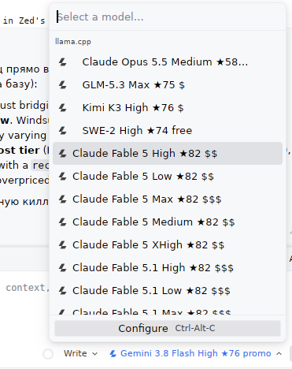

# windsurf-openai

Standalone proxy that exposes **Windsurf/Cognition/Devin models as a plain OpenAI API** — plug them into Zed, or any OpenAI-compatible client, using your existing Windsurf subscription.

The main point of this proxy isn't just bridging the protocol — it's **giving you instant clarity on what to use right now**. Windsurf has 200+ models with hidden credit costs, shifting promo windows, and wildly varying capability. This proxy decorates every model name with its **power rank and cost tier** (`Kimi K3 High ★76 $`, `SWE-2 High ★50 free`), pins top picks on top, and comes with a `recommend` command that highlights the real freebies, best-value models, and overpriced traps at a glance.

Based on [pi-windsurf](https://github.com/ktappdev/pi-windsurf) (originally a Pi extension), reworked into a pure proxy.



## Why

A Windsurf subscription gives you access to Claude, GPT, Gemini, Kimi, SWE, GLM and more — but only inside Windsurf's own IDE. Two problems with that: first, you might just prefer a different editor. Second — as of October 2026 they straight-up broke their own IDE for regular users with a botched team migration (a "team" error on launch, fix timeline unknown).

**Practical advice (October 2026):** a Pro subscription is worth it if used strategically — SWE-2 covers routine work for free, GLM-5.3 Max / Kimi K3 give the best value on subscription credits, and Gemini Flash is the safe buy once you're into Extra-Usage. Full details in [RECOMMENDATIONS.md](RECOMMENDATIONS.md) ([и рекомендации по русски](RECOMMENDATIONS_RU.md)).

- **No Windsurf IDE needed** — OAuth once, then it's just a localhost HTTP service
- **Zero dependencies** — plain Node/tsx, no npm packages
- **Live model list** — fetched from Windsurf itself (`GetUserStatus`), not a hardcoded table; new models appear automatically
- **Cost tiers in the names** — Windsurf publishes no pricing, but its API leaks credits-per-prompt and promo windows; the proxy surfaces them as `$`/`$$`/`$$$`/`promo`/`free` right in the model list, so you know what you're spending
- **Power rankings** — each model gets a `★NN` badge (Artificial Analysis index via OpenRouter's public API; SWE models are hand-estimated, override via `ranks.json`)
- **`recommend` command** — one-shot digest: what's free right now, best value, best power-per-credit, and what's overpriced
- **Zed native** — works with Zed's built-in `llama.cpp` provider: model list auto-populates with context windows, featured models pinned on top

There are alternatives ([WindsurfAPI](https://github.com/dwgx/WindsurfAPI), `windsurf2api` variants, etc.) — I tried them and none quite fit: some bundle a heavy runtime, some hardcode stale model lists, most skip Zed's auto-discovery entirely, and none show what each model costs. This one stays small, dependency-free, and honest about pricing.

## How it works

```
Zed → proxy (localhost:42100, OpenAI API) → Windsurf cloud (Connect-RPC)
```

The proxy translates standard OpenAI Chat Completions to Windsurf's proprietary wire format.

## Quick start

```bash
npx tsx cli.ts login     # browser OAuth → credentials saved to ~/.config/opencode-windsurf-auth/
npx tsx cli.ts serve     # proxy on http://127.0.0.1:42100/v1
```

(Or `bun cli.ts …` / `npm run serve`. Plain Node does not work — extensionless imports.)

## Zed setup

Use the **llama.cpp provider** (settings key: `"llama.cpp"`, URL has no `/v1` — the provider appends `/v1/models` itself):

```json
{
  "language_models": {
    "llama.cpp": {
      "api_url": "http://127.0.0.1:42100"
    }
  }
}
```

Restart Zed — the model list appears automatically: a few **featured models pinned on top** (edit `FEATURED_UIDS` in `featured.ts` to taste), then promo/free, then `$` → `$$` → `$$$`, with per-model context windows. No API key needed on localhost.

Other editors: point any OpenAI-compatible client at `http://127.0.0.1:42100/v1` (auth: Bearer key from `cli.ts status` for non-localhost clients).

## CLI

| Command | Does |
|---------|------|
| `serve` | Start the proxy (`--port`, `--host`) |
| `login` / `logout` | Browser OAuth / remove credentials |
| `status` | Show saved credentials |
| `models` | List models with cost tiers (`--zed` → ready-to-paste JSON) |
| `recommend` | What to use right now — freebies, value picks, power picks (`--all` → full table) |
| `speeds` | Refresh the TPS snapshot from OpenRouter model pages (slow one-time crawl) |
| `probe` | Dump Windsurf's raw per-model credits + prices |

## Cost tiers

Windsurf exposes no public pricing. Tiers come from its own `GetUserStatus` data: **credits per prompt** and **promo windows** (the plugin's "PROMO" badge).

| Tier | Meaning |
|---|---|
| `free` | 0-credit promo as marketed by Windsurf (the SWE line) — real freebie while the window lasts |
| `promo` | discounted window — very cheap, but still per-prompt credits |
| `$` / `$$` / `$$$` | <10 / <100 / ≥100 credits per prompt |
| `unknown` | no credits data (new models — override via `tiers.json`) |

The `★NN` badge after the name is the model's power score — Artificial Analysis coding/intelligence index fetched from OpenRouter's public models API at startup (12h cache). Models not on OpenRouter (Cognition-internal SWE) get hand-estimated scores. Override or add via `ranks.json` next to the CLI:

```json
{ "claude-opus-5-5-max": 59, "some-brand-new-model": 45 }
```

Override any tier via `tiers.json` next to the CLI (value `"blocked"` hides a model entirely).

## Behind a proxy

Outbound requests to Windsurf honor the standard `HTTPS_PROXY` / `HTTP_PROXY` / `NO_PROXY` env vars:

- **Bun** — works out of the box (`HTTPS_PROXY=http://proxy:3128 bun cli.ts serve`)
- **Node 24+** — `NODE_USE_ENV_PROXY=1 HTTPS_PROXY=http://proxy:3128 npx tsx cli.ts serve`
- **Older Node** — fetch ignores proxy env vars; run through Bun, or upgrade Node

## Security

Localhost clients are trusted without a key. With `--host 0.0.0.0`, chat requests from remote clients must send `Authorization: Bearer <apiKey>` (the model list itself — names and tiers only — stays readable without a key). Credentials stored mode 0600. Never commit API keys.

## Requirements

- tsx (`npx tsx`) or Bun — no npm dependencies
- Windsurf account (free or paid)

## Credits

Reverse-engineering by [opencode-windsurf-auth](https://github.com/rsvedant/opencode-windsurf-auth) (@rsvedant); proxy architecture from [pi-windsurf](https://github.com/ktappdev/pi-windsurf) by @ktappdev. Standalone proxy rework by @ploginoff.

## License

MIT
